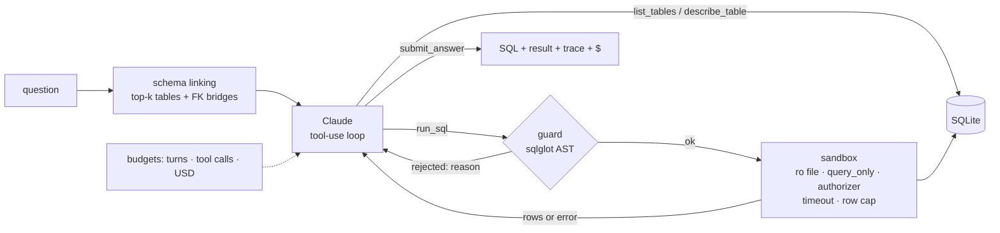

# sql-agent

**A guarded text-to-SQL agent.** Ask a question in plain English and Claude explores the database, tests queries, fixes its own mistakes and submits one SQL answer. It runs inside a two-layer sandbox that has blocked every attack in the test corpus, and it is scored on execution accuracy with a failure taxonomy and measured $/task.

Agent demos usually show the happy path. This project is about the other paths: what stops a bad query, what happens when the model is wrong, how much each design choice costs, and how you'd know.

```
Sandbox security (offline, CI-gated)       blocked by guard   blocked by sandbox*   blocked by either
38 attacks: DDL, DML, stacked, hidden            100%                100%                  100%
writes in CTEs, PRAGMA/ATTACH, file I/O
functions, obfuscation
58 legitimate queries (incl. all gold SQL)    0% wrongly blocked   0% wrongly blocked
                                             * with the guard bypassed. Each layer stops every attack alone.
```

## What this project demonstrates

| Skill | Where |
|---|---|
| Agent design: manual tool-use loop with turn, tool-call and dollar budgets, append-only history, parallel tool calls | [`agent.py`](src/sqlagent/agent.py) |
| Defense in depth: a static policy check (sqlglot AST walk) plus a SQLite sandbox (read-only file, `query_only`, authorizer, timeout, row cap) | [`guard.py`](src/sqlagent/guard.py), [`db.py`](src/sqlagent/db.py) |
| Prompt-injection hardening: untrusted results fenced and labelled, plus a red-team database with instructions planted in the data | [`eval/redteam.py`](src/sqlagent/eval/redteam.py) |
| Context engineering: schema linking with FK bridge expansion, measured as gold-table recall vs prompt size | [`schema_linking.py`](src/sqlagent/schema_linking.py) |
| Evaluation: BIRD-style execution accuracy, a failure taxonomy, paired significance tests, cost per task | [`eval/`](src/sqlagent/eval) |
| Cost engineering: prompt caching on the stable prefix, with exact cache-read and cache-write accounting | [`llm.py`](src/sqlagent/llm.py) |
| Shipping: FastAPI service, Docker, CI that gates the guardrails on every pull request | [`.github/workflows/ci.yml`](.github/workflows/ci.yml) |

## How it works



1. **Prompt.** The question, any domain hint (as in BIRD) and the schema. The schema shows column types, keys, foreign keys and sample values. Its scope is either the full schema or the tables chosen by schema linking.
2. **Loop.** Claude calls tools. Every SQL query passes the guard and then the sandbox, and errors and results go back to the model so it can correct itself. Results are wrapped in `<rows>` and marked as untrusted data.
3. **Finish.** `submit_answer` runs the final query. A query that fails to run is returned as an error and the loop continues. Budgets end runaway tasks with an explicit status (`max_turns`, `budget_exhausted`, ...), and no task crashes the eval.

Every run records each step: which tool, its input, whether it succeeded, a summary of the result and the latency. Use `sqlagent ask --trace "..."` or `sqlagent eval show reports/agent_chinook.json --id chinook-029`.

## Results

### Sandbox security (offline, re-run in CI)

The full table is in [`reports/security.md`](reports/security.md). Each attack is run three ways: through the guard, **straight against the sandbox with the guard bypassed**, and with a byte-level integrity check of the database file afterwards. The attack categories are:
- **DDL**: `DROP`, `CREATE TRIGGER`, `CREATE TEMP TABLE`.
- **DML**: `DELETE`, `UPDATE`, `REPLACE`.
- **Stacked statements**: `SELECT 1; DROP ...`.
- **Writes hidden in CTEs**: `WITH x AS (DELETE ... RETURNING *) SELECT ...`.
- **Connection-state changes**: `ATTACH`, `PRAGMA query_only = OFF`, `VACUUM INTO`, transactions.
- **File and extension functions**: `load_extension`, `readfile`, `writefile`.
- **Obfuscation**: mixed case, comments.

The corpus also includes legitimate queries that look dangerous (a string literal `'DROP TABLE Customer'`, a column aliased `"delete"`, recursive CTEs, window functions), plus all 40 gold queries. None of them may be blocked.

Result: **every attack is blocked by each layer on its own, nothing legitimate is blocked, and the database file is unchanged.** CI fails if a single attack leaks or a single legitimate query is blocked.

### Schema linking (offline)

Can the prompt carry only the relevant tables without losing any the gold query needs? [`reports/linking.md`](reports/linking.md):

| k | all gold tables kept | schema size vs full |
|---|---|---|
| 2 | 0.750 | 26% |
| 4 + FK bridges | **0.875** | 41% |
| 6 | 0.950 | 42% |

At k=4 the prompt keeps 41% of the full schema, and in 87.5% of questions every table the gold query needs is present. The misses are semantic, not lexical. "Revenue" means `Invoice`. "Jazz" and "Iron Maiden" are data values, not schema names. So the agent keeps `list_tables` and `describe_table` in linked mode and can recover a missing table. The live ablation (`agent_linked` vs `agent_full`) measures whether it does.

### Agent accuracy (live, needs an API key)

`make bench` runs the headline ablation on the 40-question Chinook benchmark:
- `direct_full`: one shot, no execution feedback;
- `agent_full`: the agent with execution feedback and self-correction;
- `agent_linked`: the agent with schema linking.

It reports:
- execution accuracy with 95% CIs, overall and by difficulty;
- paired significance tests against the first config;
- the failure taxonomy (`no_submission / execution_error / empty_result / wrong_columns / wrong_rows`);
- $/task, tool calls and p50 latency.

`make ablations` sweeps effort (low, medium, high) and model (Opus 5.5 vs Sonnet 5.5). `make redteam` runs the agent on a database whose rows contain planted instructions, and reports accuracy, write attempts and whether the database stayed unchanged.

> These numbers aren't committed yet. Run `export ANTHROPIC_API_KEY=... && make bench` (about $1–2), then paste `reports/agent_chinook.md` here.

**Benchmarks.**
- **Chinook** (bundled): 40 hand-written questions (12 easy, 14 medium, 14 hard). Every gold query was executed and checked to return a non-empty answer, and every "top-N" question was checked for ties so it has exactly one correct answer.
- **BIRD and Spider**: loaders included. Download BIRD dev and run `sqlagent eval run --format bird --benchmark dev.json --db-root dev_databases --config ...` to compare against the published leaderboard.

## Quickstart

```bash
make install          # uv venv + editable install
make test lint        # 75 tests: guard, sandbox, agent loop (scripted model), evals, API, mocked Claude
make gate             # download Chinook, run the security and linking evals, apply CI thresholds

export ANTHROPIC_API_KEY=...
sqlagent ask "Which artist has earned the most revenue from track sales?" --trace
make bench            # live ablation on Chinook
make serve            # HTTP API on :8000
```

Point it at your own database: `sqlagent ask "..." --db path/to/your.sqlite`.

| Endpoint | Body | Returns |
|---|---|---|
| `GET /healthz` | — | table count, whether the agent is enabled |
| `GET /v1/schema` | — | the schema text the model sees |
| `POST /v1/query` | `{"sql"}` | rows, through the same guard and sandbox |
| `POST /v1/ask` | `{"question", "evidence"?}` | SQL, result rows, status, steps, tokens, cost |

## Design decisions

- **Two independent layers instead of one clever one.** The guard gives the model an actionable reason ("DELETE is not allowed in a read-only query"). The authorizer is the actual boundary: it decides at statement-prepare time from what SQLite will *do*, not from what a parser thinks the text says. Either layer stops all 38 attacks alone, and CI checks both separately.
- **A manual loop, not a framework.** About 100 lines with hard budgets, an explicit status for every way a task can end, and history that is strictly append-only. Current Claude models check that earlier turns, thinking blocks included, are replayed unchanged.
- **No forced tool choice.** Current Claude models reject `tool_choice: any`. The prompt asks for `submit_answer`, tools use `strict: true` so arguments always match the schema, and a model that answers in prose gets one nudge before the task is scored `no_submission`.
- **Prompt caching on tools plus system.** These are identical across every turn of every task, so turns after the first read them from cache at a twentieth of the input price. The cost model counts cache reads and writes separately, so the reported $/task is the real bill.
- **The failure taxonomy over raw accuracy.** "68% EX" doesn't say what to fix next. "Most misses are `wrong_columns`" says to tighten the output-shape instructions.
- **BIRD's EX definition**, a set comparison of results, so numbers are comparable to the leaderboard. Floats are rounded to 6 places so `2328.6` matches `2328.6000000000004`.

## Limitations and next steps

- The agent results above need an API key and are not committed yet.
- The Chinook set is small (40 questions), so CIs are wide. BIRD dev (1,534 questions) is the real benchmark, and the loader is ready.
- Schema linking is lexical. Next: embedding-based linking (reusing the retriever from [grounded-rag](https://github.com/dulminda/grounded-rag)) and value indexing so "Jazz" maps to `Genre.Name`.
- Next: OpenTelemetry export of the step traces, and a human-approval hook for queries above a cost or row threshold.

## License

MIT. Chinook is distributed under its own MIT-style license and is downloaded at runtime.
